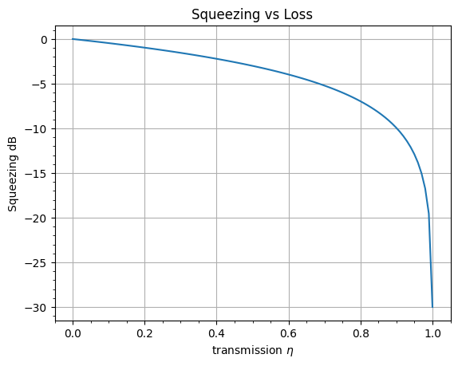

# Shot Noise and Squeezing - How Loss Affects Squeezing

Consider laser light incident on 50/50 beam splitter:

Quantum mechanically this is a coherent state: 

$$E=\ket{\alpha}$$ 

but we can write this classically as an intense field plus fluctuations: 

$$ E = \alpha + \delta \alpha + c.c.$$

With $\alpha$ being a complex number, $\delta \alpha$ being a noise term with zero mean:

$$\braket{\delta \alpha} = 0$$

and variance $V_0/2$.

and $c.c.$ being a complex conjugate.

$$ \braket{\delta \alpha \,\delta \alpha^*} = V_0/2$$

If we incident this on a beam splitter, $E$ enters on one port, but vacuum fluctuations enter on the other as well $\delta \beta$, so we get:

$$ E_{out,+} = \frac{1}{\sqrt2}(\alpha + \delta \alpha + \delta \beta) + c.c.$$

$$ E_{out,-} = \frac{1}{\sqrt2}(\alpha + \delta \alpha - \delta \beta) + c.c.$$

We then put photodetector at each output, and get photocurrents proportional to square of field:

$$ I_{\pm} = \frac{|\alpha|^2}{2} + \frac{\alpha^*}{2} (\delta \alpha \pm \delta \beta) + c.c.$$

If we subtract these two we get:

$$I = \frac{\alpha^*}{2}\delta \beta + c.c.$$

We can choose are global phase so that $\alpha$ is real so we get:

$$ I   =\alpha(\delta \beta + \delta \beta^*) \propto Q$$

which we define as a quadrature Q.

Looking at the variance of this we get:

$$ \begin{aligned}
var(Q) &= \braket{Q^2} - \braket{Q}^2 \\
&= \braket{\delta \beta^2 + \delta\beta^{*2} + 2\delta\beta\delta\beta^{*} } - \braket{\delta \beta + c.c.}^2 \\
&=  0 + 0 + 2V_0/2 + 0 - 0 \\
&= V_0
\end{aligned} $$

So mixing a coherent state with itself on a beam splitter gives the quadrature, and the variance of this gives shot noise (quadrature and varaince proportional to field $\alpha$ and intensity $|\alpha|^2$ of coherent state respectively).

What if this quadrature was made of squezed vacuum? Then $var(Q_{sq})$ would be less than $V_0$ and vice versa for anti-squeezed vacuum.

What if our squeezed vacuum experiences loss? Model this as beam splitter mixing regular vacuum into squeezed vacuum.

Write loss as $\sqrt{1-\eta}$, so we keep $\eta$ percent of the power.

Define $\delta s$ as the squeezing field, and $\delta v$ as the vacuum mixed in.

$$ Q_{loss} = \sqrt{\eta}\delta s + \sqrt{1-\eta} \delta v + c.c.$$

Since vacuum and squeezed vacuum are uncorrelated the variance is the sum of their variances.

The variance of this is:

$$ var (Q_{loss}) = \eta V_s  + (1-\eta)V_0$$

ratio of squeezing to shot noise:

$$ R = \frac{\eta V_s}{V_0} + (1-\eta)$$

If we start with a lot of squeezing, let's say 30 dB, then $V_s = .001$, we can then plot how loss degrades this:

